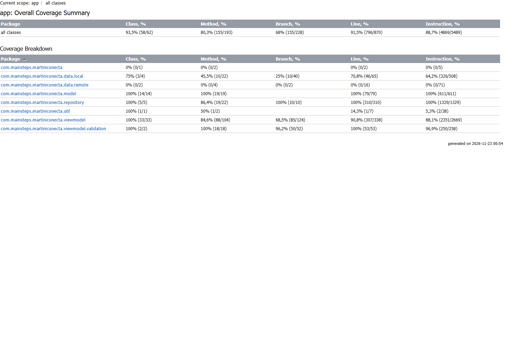

# Martini Conecta

Prototipo móvil académico desarrollado para el caso Master Martini en **DSY1105 — Desarrollo de Aplicaciones Móviles**, sección 003V, grupo 15.

## Propósito

App de contenidos técnicos para clientes y emprendedores de panadería, pastelería, heladería y gastronomía de Master Martini Chile (filial de Unigrà). Lleva del contenido al producto Martini y del producto a una conversación con ventas por WhatsApp. Diseñada para usuarios mayores de 50, con bajo manejo digital o dificultades visuales: simple, accesible y disponible sin conexión.

## Funcionalidades implementadas

- Perfil local con división, tamaño de negocio, intereses y teléfono opcional.
- Persistencia del perfil, preferencias, favoritos y solicitudes mediante Room.
- Catálogo local de 12 recetas, organizado por división y disponible sin conexión.
- Inicio personalizado según la división guardada en el perfil.
- Exploración por título y división, con detalle completo de cada receta.
- Favoritos sin duplicados que sobreviven al reinicio de la aplicación.
- Escalado de ingredientes a ×½, ×1 y ×2.
- Formulario validado «Quiero que me contacten», con datos precargados desde el perfil.
- Foto de perfil desde galería o cámara mediante Activity Result APIs y FileProvider.
- Acciones para compartir una receta y consultar a ventas mediante intents.
- Accesibilidad: tipografía escalable, preferencia de letra grande, contraste, áreas táctiles amplias y semántica para TalkBack.

## Tecnologías

- Kotlin y Jetpack Compose con Material 3.
- Navigation Compose.
- ViewModel, StateFlow y corrutinas.
- Room con migraciones para persistencia local.
- Activity Result APIs, Photo Picker, cámara y FileProvider.
- Coil para mostrar la foto de perfil.
- JUnit y kotlinx-coroutines-test para pruebas unitarias.

## Requisitos

- Android Studio con JDK 17.
- Android SDK Platform 37 y Build Tools 36.0.0.
- Dispositivo o emulador con Android 7.0 (API 24) o superior.

El proyecto incluye Gradle Wrapper 9.6.0, por lo que no requiere una instalación global de Gradle.

## Ejecución

1. Clona el repositorio y ábrelo en Android Studio.
2. Espera la sincronización de Gradle.
3. Selecciona un dispositivo o emulador con API 24 o superior.
4. Ejecuta la configuración `app`.

También puedes verificar el proyecto desde una terminal en la raíz:

```powershell
.\gradlew.bat assembleDebug testDebugUnitTest lintDebug
```

En macOS o Linux:

```bash
./gradlew assembleDebug testDebugUnitTest lintDebug
```

La APK de depuración se genera en `app/build/outputs/apk/debug/app-debug.apk`.

## Verificación final

Antes del congelamiento se comprueba:

- onboarding → Inicio → Explorar → Detalle → Favoritos;
- persistencia del perfil y de favoritos después de reiniciar;
- edición del perfil, galería, cámara y formulario de contacto;
- compartir y consultar a ventas mediante intents;
- fuente del sistema al máximo y lectura de acciones con TalkBack;
- `assembleDebug`, `testDebugUnitTest`, `lintDebug` y `git diff --check`.

Los datos ingresados durante las pruebas deben ser ficticios.

## Equipo

- Diego Alonso Pazos Atarama — [@MainSteps](https://github.com/MainSteps)
- Matías Urrejola — [@MatiasU-24](https://github.com/MatiasU-24)

## Gestión del proyecto (GitHub Projects en lugar de Trello)

La planificación vive en el [GitHub Project del equipo](https://github.com/users/MainSteps/projects/2), que reemplaza a Trello (la pauta acepta "Trello o similar").

- Columnas: **Por hacer → En curso → Hecho**.
- Cada tarjeta es una issue con responsable y label de nivel (`nivel 1: pauta`, `nivel 2: diferenciador`, `nivel 3: extra`).
- Flujo: **issue → rama `feat/<n>-…` → PR con `Closes #<n>` y revisión cruzada → Squash and merge → Hecho**.
- Cada integrante commitea desde su propia cuenta; no hay commits directos a `main`.

Detalle en [CONTRIBUTING.md](CONTRIBUTING.md) y contexto completo en [docs/contexto/contexto.md](docs/contexto/contexto.md).

## Contexto

Este repositorio corresponde a un prototipo académico basado en un desafío empresarial real. No implica que Master Martini haya contratado, aprobado o utilizado la aplicación. Marca, productos y WhatsApp se usan en modo demo con el aviso "Prototipo académico, no oficial".

## Microservicio `martini-api`

El microservicio Spring Boot del equipo está en [MainSteps/martini-api](https://github.com/MainSteps/martini-api). La app permite crear, consultar, editar y eliminar solicitudes mediante Retrofit. Clona el repositorio de la API y, desde su carpeta, inicia el servicio con JDK 17 o superior.

Windows:

```powershell
.\mvnw.cmd spring-boot:run
```

macOS/Linux:

```bash
./mvnw spring-boot:run
```

En el PC, la API responde en `http://localhost:8080/`. La integración de Android usa `http://10.0.2.2:8080/` para llegar desde el emulador al puerto `8080` del equipo. Si ejecutas la API en un entorno remoto de VS Code, reenvía su puerto 8080 al PC antes de iniciar la app. Para un dispositivo conectado por ADB, puedes ejecutar el siguiente comando y configurar la URL del cliente como `http://localhost:8080/`:

```powershell
adb reverse tcp:8080 tcp:8080
```

| Método | Ruta | Uso |
| --- | --- | --- |
| `GET` | `/api/solicitudes` | Listar solicitudes |
| `GET` | `/api/solicitudes?telefono=...` | Filtrar por el teléfono del perfil |
| `POST` | `/api/solicitudes` | Crear una solicitud |
| `GET` | `/api/solicitudes/{id}` | Obtener una solicitud |
| `PUT` | `/api/solicitudes/{id}` | Actualizar una solicitud |
| `DELETE` | `/api/solicitudes/{id}` | Eliminar una solicitud |

Ejemplo de respuesta:

```json
{
  "id": 4,
  "nombre": "Ana Soto",
  "telefono": "+56 9 8765 4321",
  "division": "PANADERIA_PASTELERIA",
  "comuna": "Ñuñoa",
  "producto": "MANTECA_UNIGRAL",
  "creadaEn": 1795058223282,
  "estado": "PENDIENTE"
}
```

## Tests y cobertura

Ejecuta las pruebas unitarias, genera los reportes de Kover y verifica el umbral de cobertura.

Windows:

```powershell
.\gradlew.bat testDebugUnitTest
.\gradlew.bat koverHtmlReportDebug
.\gradlew.bat koverXmlReportDebug koverVerifyDebug assembleDebug
```

macOS/Linux:

```bash
./gradlew testDebugUnitTest
./gradlew koverHtmlReportDebug
./gradlew koverXmlReportDebug koverVerifyDebug assembleDebug
```

El reporte HTML se genera en `app/build/reports/kover/htmlDebug/index.html` y el XML en `app/build/reports/kover/reportDebug.xml`. La medición del 23/11/2026 sobre `main` (`d46a5ba`, con el CRUD completo) más los cambios de #53 obtuvo **796 de 870 líneas: 91,49%**, con **61 tests aprobados**, sin fallos, errores ni omitidos. `koverVerifyDebug` exige al menos 80% de cobertura de líneas y pasó junto con `assembleDebug`.

Kover excluye pantallas, componentes y tema Compose, navegación, `MainActivity`, configuración de Room y sus implementaciones generadas, y factories de ViewModel. Son presentación, infraestructura Android o código generado; las pruebas unitarias miden la lógica de ViewModels, repositorios y validadores. También se excluye `ContactoVentasKt`, que prepara intents Android para abrir aplicaciones externas. Esta medición no acredita pruebas de interfaz ni recorridos en emulador.

Los tests usan JUnit y `kotlinx-coroutines-test`, con dependencias falsas que permiten comprobar estados y resultados sin ejecutar Room ni una API real. La validación del correo usa una expresión regular en Kotlin para poder probarla en la JVM sin depender de `android.util.Patterns`.



La medición incluye el CRUD de solicitudes de #50 y #51 integrado en `main`, con pruebas de recarga, validación de comuna, cancelación, errores de PUT/DELETE y reintento. El recorrido real con la API está documentado en [las evidencias de #51](docs/evidencias/51-recorrido.md).
